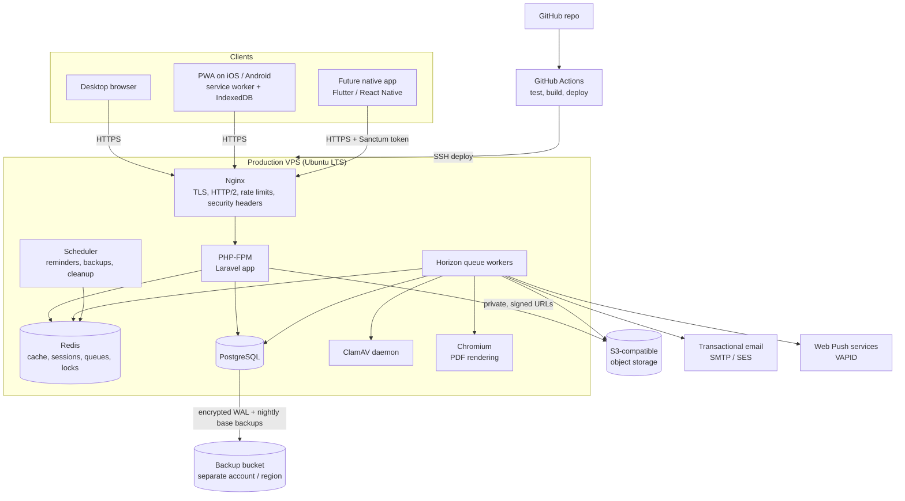

# A. System Architecture

## Diagram

## How a request flows

1. **Browser → Nginx.** TLS terminates at Nginx. It serves compiled static assets (JS/CSS/icons) directly with long cache headers, and passes everything else to PHP-FPM.
2. **Laravel middleware.** The session is checked, CSRF is verified on writes, rate limits are applied, and the active family is resolved from the URL (`/families/{family}/...`).
3. **Authorisation.** A Policy checks the user's role in that family, then record-level privacy (for example, living-person masking).
4. **Action.** A single-purpose Action class performs the work in a database transaction and writes the audit log.
5. **Inertia response.** The controller returns a React page name plus typed props. On first load this is a full HTML page; afterwards Inertia swaps pages with JSON over XHR, so it feels like a single-page app without a separate public API.
6. **Slow work goes to queues.** Thumbnails, malware scans, PDF generation, GEDCOM imports, emails and push notifications all run in Horizon workers, so pages stay fast.

## Key decisions

### Inertia.js monolith (rather than a separate SPA + REST API)
- **What:** Laravel controllers render React pages directly. There is no separate frontend server.
- **Why:** One codebase, one deployment, one authentication system (session cookies). Laravel's CSRF, validation and authorisation apply to every page automatically.
- **How:** `Inertia::render('Members/Show', [...props])`. Props are built by API Resource classes, which strip fields the viewer may not see.
- **Advantages:** Faster development, smaller attack surface (no public data API for the web app), and server-side authorisation on every page.
- **Limitations:** Pages need the server, so offline mode needs a dedicated offline viewer (see [PWA](07-pwa.md)). Native apps need a separate token API, which is planned as `/api/v1` reusing the same Actions and Resources.

### Redis for cache, sessions, queues and locks
- **What:** In-memory store.
- **Why:** Queue throughput, fast session lookups, cached tree graphs for the relationship finder, and atomic locks (to stop two people editing the same relationship at once).
- **Limitations:** Data in Redis is treated as disposable. Nothing exists only in Redis. It is bound to localhost and password-protected.

### Horizon for queue workers
- **What:** Laravel's Redis queue supervisor with a dashboard.
- **Why:** Separate queues with priorities (`default`, `media`, `reports`, `notifications`, `imports`), so a large GEDCOM import cannot delay password-reset emails.
- **Limitations:** Needs a process supervisor (systemd), so it needs a VPS.

### Object storage (rather than local disk) for files
- **What:** Photos and documents live in a private S3-compatible bucket.
- **Why:** Storage grows independently of the server, survives server rebuilds, and supports versioning for accidental-deletion recovery.
- **How:** Files are never public. The app checks permission, then issues a short-lived (5-minute) signed URL.
- **Limitations:** Ongoing cost per GB. Signed URLs can be shared for their short lifetime.
