# B & C. Database Architecture (PostgreSQL)

## Conventions

| Convention | Choice | Why |
|---|---|---|
| Primary keys | `uuid` (UUIDv7, time-ordered) | Not guessable in URLs (no `/members/1`, `/members/2` enumeration). Can be generated on a phone while offline, which helps future sync. v7 keeps index inserts ordered, unlike random v4. Cost: 16 bytes vs 8, negligible here. Exception: `audit_logs` uses `bigint identity` (append-only, very high volume, never exposed). |
| Tenant column | `family_id` on every family-owned table | Every query is scoped by family. |
| Tenant integrity | **Composite foreign keys** `(family_id, member_id) → family_members(family_id, id)` | The database itself refuses to link a person in family A to a person or photo in family B, even if application code has a bug. |
| Soft deletes | `deleted_at` on user-facing records | Mistakes can be undone. A scheduled job purges after 30 days (and immediately on account deletion requests). |
| Timestamps | `timestamptz`, stored in UTC | Shown in the user's timezone (default `Asia/Kuala_Lumpur`). |
| Text | `text` with application length limits; `citext` for emails | Case-insensitive email uniqueness. |
| Enums | `text` + `CHECK` constraint, mirrored by PHP backed enums | Easier to extend than native PG enums (no `ALTER TYPE` migrations). |
| Optimistic locking | `version integer` on editable genealogy records | Two editors cannot silently overwrite each other. The second save gets a "this record changed" prompt. |
| Extensions | `citext`, `pg_trgm`, `unaccent` | Case-insensitive email; fuzzy and accent-insensitive name search. |

### Fuzzy dates (uncertain historical information)

Genealogy dates are often incomplete ("about 1920", "before 1945", "between 1890 and 1895", "Ramadan 1935"). Every historical date is stored as a group of five columns, handled in Laravel by one `FuzzyDate` value object and cast:

| Column suffix | Type | Example |
|---|---|---|
| `_date` | `date` null | `1920-01-01` (earliest possible date, used for sorting and search) |
| `_date_to` | `date` null | `1925-12-31` (only for ranges) |
| `_date_precision` | `text` | `day`, `month`, `year`, `decade`, `unknown` |
| `_date_qualifier` | `text` | `exact`, `about`, `estimated`, `calculated`, `before`, `after`, `between` |
| `_date_text` | `text` null | Original wording, e.g. "during the Japanese occupation". Preserved as GEDCOM date phrases. |

This maps one-to-one onto GEDCOM 7 date syntax (`ABT 1920`, `BEF 1945`, `BET 1890 AND 1895`), so import/export loses nothing.

---

## B. Entity Relationship Diagram

```mermaid
erDiagram
  users ||--o{ family_user : "belongs to"
  users ||--o{ social_accounts : has
  users ||--o{ login_activities : logs
  users ||--o{ push_subscriptions : has
  users ||--o{ notifications : receives
  families ||--o{ family_user : has
  family_roles ||--o{ family_user : "role of"
  family_roles ||--o{ family_role_permissions : grants
  family_permissions ||--o{ family_role_permissions : "granted by"
  families ||--o{ family_invitations : issues
  families ||--o{ family_members : contains
  families ||--o{ places : defines
  family_members ||--o{ family_relationships : "person_a"
  family_members ||--o{ family_relationships : "person_b"
  family_members ||--o{ member_names : "also known as"
  places ||--o{ family_members : "birth / death / hometown"
  family_user }o--o| family_members : "is me in tree"
  families ||--o{ family_timeline : records
  family_timeline ||--o{ timeline_participants : involves
  family_members ||--o{ timeline_participants : "takes part"
  families ||--o{ family_events : schedules
  families ||--o{ photo_albums : has
  photo_albums ||--o{ family_photos : groups
  families ||--o{ family_photos : stores
  families ||--o{ family_documents : stores
  family_photos ||--o{ member_photos : tags
  family_members ||--o{ member_photos : "appears in"
  family_documents ||--o{ member_documents : concerns
  family_members ||--o{ member_documents : "subject of"
  family_timeline ||--o{ timeline_attachments : has
  family_photos ||--o{ timeline_attachments : attached
  family_documents ||--o{ timeline_attachments : attached
  families ||--o{ change_requests : receives
  users ||--o{ change_requests : submits
  families ||--o{ activity_logs : feed
  families ||--o{ audit_logs : audited
  families ||--o{ gedcom_imports : imports
  families ||--o{ report_exports : exports

  users {
    uuid id PK
    citext email UK
    text name
    text password "argon2id"
    bool is_super_admin
    text status "active | deactivated | suspended"
    text two_factor_secret "encrypted"
    timestamptz email_verified_at
    timestamptz deleted_at
  }
  families {
    uuid id PK
    text name
    text slug UK
    uuid owner_id FK
    uuid root_member_id FK "nullable"
    bigint graph_version
    bigint storage_bytes_used
    bigint storage_quota_bytes
  }
  family_user {
    uuid id PK
    uuid family_id FK
    uuid user_id FK
    smallint role_id FK
    uuid linked_member_id FK "nullable"
    text status
  }
  family_roles {
    smallint id PK
    text key UK "owner | admin | editor | contributor | viewer"
    smallint rank
  }
  family_permissions {
    smallint id PK
    text key UK "members.update, media.upload ..."
  }
  family_members {
    uuid id PK
    uuid family_id FK
    text full_name
    text surname "nullable"
    text gender "nullable"
    date birth_date "+ fuzzy columns"
    date death_date "+ fuzzy columns"
    text living_status "living | deceased | unknown"
    text visibility
    bool is_placeholder
    smallint generation "derived"
    tsvector search_vector "generated"
    int version
  }
  family_relationships {
    uuid id PK
    uuid family_id FK
    text type "parent_child | partnership"
    uuid person_a_id FK "parent or partner"
    uuid person_b_id FK "child or partner"
    text subtype "biological | adoptive | step | ..."
    text status "current | divorced | widowed ..."
    text certainty
    date start_date "+ fuzzy"
    date end_date "+ fuzzy"
  }
  change_requests {
    uuid id PK
    uuid family_id FK
    text target_type
    uuid target_id "nullable for create"
    text action "create | update | delete"
    jsonb payload
    int base_version
    text status
  }
  audit_logs {
    bigint id PK
    uuid family_id "nullable"
    uuid user_id
    text action
    jsonb old_values
    jsonb new_values
    inet ip_address
    timestamptz created_at
  }
```

Columns are abbreviated in the diagram. The full definitions follow.

---

## C. Table Specifications

`PK` primary key · `FK` foreign key · `UK` unique · `NN` not null · `ts` = `created_at`, `updated_at` (timestamptz).

### Identity and access

#### `users`
| Column | Type | Notes |
|---|---|---|
| id | uuid PK | |
| name | text NN | |
| email | citext NN UK | |
| email_verified_at | timestamptz | Unverified users cannot create or join a family. |
| password | text null | Argon2id hash. Null for social-only accounts. |
| is_super_admin | boolean NN default false | Platform staff only. Never granted via the UI; set by an artisan command. |
| status | text NN default `active` | `active`, `deactivated` (by user), `suspended` (by admin). |
| locale | text NN default `en` | `en`, `ms` (Bahasa Malaysia, later). |
| timezone | text NN default `Asia/Kuala_Lumpur` | |
| avatar_path | text | |
| two_factor_secret | text | Encrypted (Laravel Fortify). |
| two_factor_recovery_codes | text | Encrypted. |
| two_factor_confirmed_at | timestamptz | |
| last_login_at | timestamptz | |
| remember_token | text | |
| deleted_at, ts | | |

#### `social_accounts`
`id`, `user_id FK→users ON DELETE CASCADE`, `provider` (`google`, `apple`), `provider_user_id`, `ts`. **UK** `(provider, provider_user_id)`. OAuth tokens are not stored (only needed at login).

#### `login_activities`
`id`, `user_id FK null`, `email_attempted citext`, `event` (`login`, `logout`, `failed`, `mfa_failed`, `lockout`, `password_reset`, `mfa_enabled`, `mfa_disabled`), `ip_address inet`, `user_agent text`, `created_at`. Index `(user_id, created_at desc)`. Retained 12 months.

#### `sessions` (Laravel database session driver)
Standard Laravel table (`id`, `user_id`, `ip_address`, `user_agent`, `payload`, `last_activity`). Sessions live in PostgreSQL (not Redis) so users can see and revoke their active devices.

#### `push_subscriptions`, `notifications`
Standard tables from `laravel-notification-channels/webpush` and Laravel notifications (`data` as `jsonb`). Plus `notification_preferences (user_id, family_id null, channel, type, enabled)`.

### Families and membership

#### `families`
| Column | Type | Notes |
|---|---|---|
| id | uuid PK | |
| name | text NN | |
| slug | text NN UK | Used in URLs. |
| description | text | |
| cover_photo_id | uuid null | FK → family_photos (deferred; added after that table). |
| owner_id | uuid NN FK→users | Exactly one owner; ownership transfer is an explicit action. |
| root_member_id | uuid null | Default focus person for the tree view. Composite FK to `family_members`. |
| settings | jsonb NN default `{}` | Privacy defaults, approval policy (e.g. "contributors' edits need approval"). |
| graph_version | bigint NN default 0 | Bumped on every relationship change. Used as a cache key for tree and relationship-finder data. |
| storage_bytes_used | bigint NN default 0 | Maintained by media jobs. |
| storage_quota_bytes | bigint NN | Default set in config (e.g. 10 GB). |
| deleted_at, ts | | |

#### `family_roles` (seeded, system-wide)
`id smallint PK`, `key text UK`, `name text`, `rank smallint`. Rows: owner (50), admin (40), editor (30), contributor (20), viewer (10). Rank allows rules like "you can only assign roles below your own".

#### `family_permissions` and `family_role_permissions` (seeded)
`family_permissions(id smallint PK, key text UK, description)`, e.g. `members.view_private`, `members.update`, `relationships.manage`, `media.upload`, `media.delete_any`, `changes.review`, `members.invite`, `roles.assign`, `reports.export`, `gedcom.import`, `family.delete`.
`family_role_permissions(role_id FK, permission_id FK)`, PK on both. This is the matrix in [05-roles-permissions.md](05-roles-permissions.md). Seeded and version-controlled; families cannot invent custom roles in v1.

#### `family_user` (memberships)
| Column | Type | Notes |
|---|---|---|
| id | uuid PK | |
| family_id | uuid NN FK→families CASCADE | |
| user_id | uuid NN FK→users CASCADE | |
| role_id | smallint NN FK→family_roles | |
| linked_member_id | uuid null | "This person in the tree is me". Composite FK. Used for "my relationship to X" and for letting people edit their own profile. |
| status | text NN | `active`, `suspended`. |
| invited_by | uuid null FK→users | |
| joined_at, ts | | |

**UK** `(family_id, user_id)`. **UK** `(family_id, linked_member_id)` where not null (one account per person).

#### `family_invitations`
`id`, `family_id FK`, `email citext NN`, `role_id FK`, `token_hash text NN UK` (SHA-256 of the token; the raw token exists only in the email link), `invited_by FK`, `message text`, `expires_at NN` (default 7 days), `accepted_at`, `accepted_by FK null`, `revoked_at`, `ts`.
Partial **UK** `(family_id, email) WHERE accepted_at IS NULL AND revoked_at IS NULL` (one open invite per email per family).

### Genealogy

#### `places`
`id`, `family_id FK`, `name text NN` (as entered, e.g. "Kampung Sinakagon, Ranau"), `locality`, `district`, `state`, `country_code char(2)`, `latitude numeric(9,6)`, `longitude numeric(9,6)`, `ts`. **UK** `(family_id, id)`. Trigram index on `name`.
A separate table (rather than free text on each person) makes location search, "everyone born in Ranau" and future migration maps possible, and fixes spelling once for everyone.

#### `family_members`
| Column | Type | Notes |
|---|---|---|
| id | uuid PK | |
| family_id | uuid NN FK→families | **UK** `(family_id, id)`, the target of composite FKs. |
| full_name | text NN | As the person is known. See the naming note below. |
| given_names | text | Optional structured parts for sorting. |
| surname | text | Optional. Many Malaysians have no surname. |
| maiden_name | text | |
| nickname | text | |
| gender | text null | `male`, `female`, `other`, `unknown`. Optional. |
| birth_date … birth_date_text | fuzzy date | |
| birth_place_id | uuid null | Composite FK → places. |
| birth_month, birth_day | smallint, **generated** | From `birth_date` when precision = day. Powers birthday reminders. |
| living_status | text NN default `unknown` | `living`, `deceased`, `unknown`. Unknown is treated as living for privacy unless born more than 110 years ago. |
| death_date … death_date_text | fuzzy date | |
| death_place_id | uuid null | |
| hometown_place_id | uuid null | |
| occupation, education, nationality | text | |
| biography | text | Sanitised rich text (HTML allow-list). |
| notes | text | Visible only to editors and above. |
| profile_photo_id | uuid null | Composite FK → family_photos. |
| visibility | text NN default `family` | `family` (all members per role rules), `restricted` (editors and above), `private` (owner and admins only). |
| is_placeholder | boolean NN default false | An unknown person (e.g. "Unknown mother") that holds a family together so siblings can be connected. |
| generation | smallint null | **Derived.** Recomputed by a queued job after relationship changes. Not editable. |
| search_vector | tsvector **generated** | From names (with `unaccent`). |
| version | int NN default 1 | Optimistic lock. |
| created_by, updated_by | uuid FK→users | |
| deleted_at, ts | | |

**Naming note (Malaysian context):** Malay and many Bornean names are patronymic (Ali bin Ahmad), Chinese names put the surname first, and Indian names may use a/l or a/p. So `full_name` is the authoritative display name, entered as the family writes it. `given_names`/`surname` are optional helpers for sorting and GEDCOM export. Nothing forces a Western first-name/last-name structure.

#### `member_names` (alternate and previous names)
`id`, `family_id`, `member_id` (composite FK, CASCADE), `type` (`birth`, `married`, `religious`, `alias`, `romanised`, `other`), `name text NN`, `notes`, `ts`. Included in search.

#### `family_relationships`
The core table. See [03-relationship-modelling.md](03-relationship-modelling.md) for the reasoning.

| Column | Type | Notes |
|---|---|---|
| id | uuid PK | |
| family_id | uuid NN | |
| type | text NN | `parent_child` or `partnership`. |
| person_a_id | uuid NN | parent_child: the **parent**. partnership: the partner with the lower id. |
| person_b_id | uuid NN | parent_child: the **child**. partnership: the other partner. |
| subtype | text NN | parent_child: `biological`, `adoptive`, `step`, `foster`, `guardian`, `unknown`. partnership: `marriage`, `customary_marriage`, `civil_union`, `partner`, `engaged`. |
| status | text null | partnership only: `current`, `divorced`, `separated`, `widowed`, `annulled`. |
| certainty | text NN default `confirmed` | `confirmed`, `probable`, `possible`, `disputed`. |
| start_date … / end_date … | fuzzy dates | Marriage/adoption date; divorce/end date. |
| place_id | uuid null | Marriage place. |
| sequence | smallint null | Order of a person's marriages when dates are unknown. |
| notes | text | |
| created_by, updated_by, deleted_at, ts | | |

Constraints:
- Composite FKs `(family_id, person_a_id)` and `(family_id, person_b_id)` → `family_members(family_id, id)`.
- `CHECK (person_a_id <> person_b_id)` (nobody is their own parent or spouse).
- `CHECK` subtype is valid for type; `status` is only set for partnerships.
- `CHECK (type <> 'partnership' OR person_a_id < person_b_id)` (canonical order, so A–B and B–A cannot both exist).
- Partial **UK** `(person_a_id, person_b_id) WHERE type = 'parent_child' AND deleted_at IS NULL` (one parent link per pair).
- **Trigger** `enforce_parent_child_rules` (constraint trigger, deferrable): rejects cycles (a person becoming their own ancestor), more than two *biological* parents per child, and a person being both parent and partner of the same person.

#### `family_timeline` (historical life events)
`id`, `family_id`, `category` (`education`, `career`, `migration`, `reunion`, `military`, `religious`, `residence`, `achievement`, `other`), `title NN`, `description`, fuzzy `event_date`, `place_id`, `visibility`, `created_by`, `updated_by`, `deleted_at`, `ts`.

Births, deaths and marriages are **not** stored here. The timeline view merges them in from `family_members` and `family_relationships`, so a date corrected in one place is correct everywhere.

#### `timeline_participants`
`timeline_id` (CASCADE), `member_id` (composite FK), `role text` (e.g. "graduate", "host"). PK `(timeline_id, member_id)`.

#### `family_events` (upcoming gatherings and announcements)
`id`, `family_id`, `type` (`reunion`, `celebration`, `memorial`, `announcement`, `other`), `title NN`, `description`, `starts_at timestamptz`, `ends_at`, `all_day bool`, `location_text`, `place_id`, `created_by`, `notify_members bool`, `deleted_at`, `ts`. After it happens, an event can be turned into a timeline entry with one click.

### Media

#### `photo_albums`
`id`, `family_id`, `title NN`, `description`, `cover_photo_id null`, `family_event_id null`, `created_by`, `deleted_at`, `ts`.

#### `family_photos`
| Column | Type | Notes |
|---|---|---|
| id, family_id | uuid | **UK** `(family_id, id)`. |
| album_id | uuid null | Composite FK → photo_albums. |
| storage_key | text NN | Object key, e.g. `families/{family}/photos/{id}/original.jpg`. Never user-controlled. |
| variants | jsonb | Thumbnail and display-size keys. |
| original_filename | text | Shown only; never used as a path. |
| mime_type | text NN | Detected from content, not the client. |
| size_bytes | bigint NN | |
| width, height | int | |
| sha256 | char(64) NN | Duplicate detection per family. |
| taken_date … | fuzzy date | "Year" filtering. |
| caption, description | text | |
| status | text NN | `quarantined` → `ready` or `rejected`. Only `ready` files are ever served. |
| visibility | text NN default `family` | |
| uploaded_by, deleted_at, ts | | |

#### `family_documents`
Same media columns as photos, plus `category` (`birth_certificate`, `marriage_certificate`, `death_certificate`, `letter`, `land_record`, `religious_record`, `other`), `page_count`, `preview_key` (PDF/image preview), `downloadable bool` (an admin can allow view-only).

#### Link tables (explicit, so foreign keys keep working)
- `member_photos (member_id, photo_id, is_primary, region jsonb null)` ("tagged in this photo"; `region` reserved for future face boxes).
- `member_documents (member_id, document_id)`.
- `timeline_attachments (id, timeline_id, photo_id null, document_id null, CHECK exactly one set)`.

Separate tables instead of one polymorphic `attachments` table: polymorphic links cannot have foreign keys, so they can point at deleted or cross-family records.

### Collaboration and audit

#### `change_requests`
| Column | Type | Notes |
|---|---|---|
| id, family_id | uuid | |
| submitted_by | uuid NN FK→users | |
| target_type | text NN | `member`, `relationship`, `timeline`, `photo`, `document`. |
| target_id | uuid null | Null for "create". |
| action | text NN | `create`, `update`, `delete`. |
| payload | jsonb NN | The proposed field values (validated at submission with the same rules as a direct edit). |
| base_version | int null | Version of the target when proposed. A mismatch at review time means "the record changed since"; the reviewer sees a 3-way diff. |
| status | text NN | `pending`, `approved`, `rejected`, `withdrawn`, `superseded`. |
| reviewer_id, reviewed_at, review_note | | |
| applied_at | timestamptz | |
| ts | | |
Index `(family_id, status, created_at)`.

#### `activity_logs` (human-readable feed)
`id`, `family_id`, `user_id`, `verb` (`member.created`, `photo.uploaded`, ...), `subject_type`, `subject_id`, `summary text`, `created_at`. Powers "Recent activities". Pruned after 2 years.

#### `audit_logs` (security record, append-only)
`id bigint identity PK`, `family_id null`, `user_id null`, `action`, `auditable_type`, `auditable_id`, `old_values jsonb`, `new_values jsonb`, `ip_address inet`, `user_agent`, `request_id uuid`, `created_at`.
- The application's database role has **INSERT and SELECT only** (no UPDATE/DELETE), so not even a compromised app can rewrite history.
- Partitioned by month; retained 7 years (configurable).
- Sensitive values (passwords, MFA secrets, tokens) are never written.

#### `gedcom_imports`, `report_exports`
`gedcom_imports`: `id`, `family_id`, `uploaded_by`, `storage_key`, `status` (`uploaded`, `parsing`, `preview_ready`, `importing`, `completed`, `failed`, `cancelled`), `summary jsonb` (counts, warnings, likely duplicates), `mapping jsonb` (user's decisions: merge/skip/create), `ts`.
`report_exports`: `id`, `family_id`, `requested_by`, `type`, `parameters jsonb`, `status`, `storage_key`, `expires_at` (files auto-deleted after 7 days), `ts`.

### Reserved for later (not created in v1)
`ai_suggestions` (type, payload, status, decided_by). AI output always lands here as a suggestion awaiting human approval, never directly in genealogy tables. Also `event_rsvps` and `translations`.

---

## Indexing strategy

| Purpose | Index |
|---|---|
| Tenant scoping | Every FK and every `family_id` (btree). Composite indexes lead with `family_id`. |
| Tree traversal | `family_relationships (family_id, person_a_id, type)` and `(family_id, person_b_id, type)` with `WHERE deleted_at IS NULL`. |
| Name search | GIN on `family_members.search_vector`; GIN `gin_trgm_ops` on `full_name` and `member_names.name` (fuzzy matches like "Lidau" ≈ "Lidow"). |
| Year filters | `family_members (family_id, birth_date)` and `(family_id, death_date)`. |
| Birthdays | `family_members (family_id, birth_month, birth_day) WHERE living_status <> 'deceased'`. |
| Generation filter | `family_members (family_id, generation)`. |
| Media | `family_photos (family_id, album_id)`, `(family_id, sha256)`, `(family_id, taken_date)`. |
| Review queue | `change_requests (family_id, status, created_at)`. |
| Audit | BRIN on `audit_logs.created_at` (tiny and fast for append-only time ranges); btree `(family_id, created_at)`. |
| Soft deletes | Partial indexes `WHERE deleted_at IS NULL` on the hot tables. |

**Scale check:** a tree of 10,000 people has roughly 20,000–30,000 relationship rows. Recursive CTE ancestor/descendant queries over that are single-digit milliseconds with the indexes above. If trees ever reach hundreds of thousands of people, a closure table (`member_ancestry`) can be added without changing the core model.

## Validation rules (applied in Laravel Form Requests, mirrored in the DB where possible)

- Death date cannot be before birth date (allowing for fuzzy ranges overlapping).
- A parent should be at least 10 years older than the child when both dates are known. This is a **warning**, not a block, because historical data is messy.
- Partnership dates must fall within both partners' lifetimes (warning).
- No cycles, at most 2 biological parents, no self-links (block, enforced in DB).
- `living_status = deceased` is required if a death date is set.
- Names: 1–200 characters, Unicode letters allowed (Jawi, Chinese and Tamil scripts included).
- Uploads: allow-listed types (JPEG, PNG, WebP, HEIC → converted to JPEG; PDF, TIFF for documents), max 25 MB photos / 50 MB documents (configurable), within family quota.
- Emails: RFC-valid with DNS check on registration.

## Migrations and seeders

- One migration per table, in dependency order. Triggers and partial indexes in raw SQL migrations (`DB::statement`).
- **Seeders, production:** `family_roles`, `family_permissions`, `family_role_permissions` only.
- **Seeders, development/staging only:** a demo family (four generations, multiple marriages, an adoption, half-siblings) used by the automated tests of the relationship finder. Never run in production (guarded by environment check).

## Backup and recovery (summary; details in [09-hosting-deployment.md](09-hosting-deployment.md))

- **Continuous:** pgBackRest streams WAL to an encrypted object-storage bucket, so we can restore to any point in the last 14 days (RPO ≈ 1 minute).
- **Daily:** full/differential base backups, encrypted (AES-256), retained 30 days; monthly kept 12 months.
- **Media:** bucket versioning + daily replication to a second bucket.
- **Monthly restore test:** an automated job restores the latest backup to a scratch database and runs integrity checks. A backup that has never been restored is not a backup.
