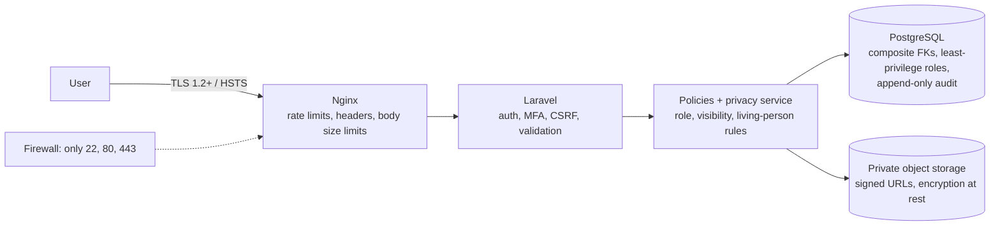

# H. Security Architecture

Baseline: **OWASP ASVS 5.0 Level 2** (the level recommended for applications handling personal data), with the OWASP Top 10 as the checklist for reviews. Malaysia's **PDPA 2010 (as amended 2024)** shapes the privacy controls.

## Layers

## Controls by area

### Authentication

| Control            | Implementation                                                                                                                                                                               |
| ------------------ | -------------------------------------------------------------------------------------------------------------------------------------------------------------------------------------------- |
| Password hashing   | **Argon2id** (`HASH_DRIVER=argon2id`, memory 64 MB, time 4, threads 1; tuned on the VPS to ~250 ms).                                                                                         |
| Password policy    | Minimum 12 characters, no forced complexity rules, checked against breached-password lists (Laravel `Password::uncompromised()`, k-anonymity, no password leaves the server).                |
| MFA                | TOTP (authenticator app) via Fortify, with 8 single-use recovery codes. **Required** for Owners, Admins and Super Admins; optional for others. WebAuthn/passkeys planned as a later upgrade. |
| Brute force        | Login rate-limited per email+IP (5/min) and per IP; progressive lockout; all attempts in `login_activities`.                                                                                 |
| Email verification | Required before creating or joining a family.                                                                                                                                                |
| Password reset     | Single-use token, 60-minute expiry, hashed in DB; same response whether or not the email exists (no account enumeration); all other sessions are revoked after reset.                        |
| Social login       | Socialite with `state` checking; an existing account is only linked after the user logs in to it (prevents account takeover through an unverified Google email).                             |
| Re-authentication  | Required for sensitive actions: change email/password, disable MFA, export data, delete account or family, transfer ownership.                                                               |

### Sessions and cookies

- Database-backed sessions, regenerated on login and privilege change; 2-hour idle timeout (configurable), "remember me" 30 days.
- Cookies: `Secure`, `HttpOnly`, `SameSite=Lax`, `__Host-` prefix for the session cookie.
- Users see their active sessions (device, IP region, last active) and can revoke any or all.

### Authorisation and tenant isolation

- Policies on every route (enforced by an architecture test).
- Scoped route binding + global family scope + composite foreign keys (three layers).
- Cross-family access returns `404`.
- Super Admins need a time-limited, owner-granted, audited support grant to see family data.

### Input, output and injection

| Threat              | Defence                                                                                                                                                                                                                             |
| ------------------- | ----------------------------------------------------------------------------------------------------------------------------------------------------------------------------------------------------------------------------------- |
| SQL injection       | Eloquent / query builder parameter binding only. Raw SQL only in migrations and reviewed query classes, always with bindings. Larastan rule flags string-built queries.                                                             |
| XSS                 | React escapes output by default. `dangerouslySetInnerHTML` is banned by lint rule except in one `SafeHtml` component that renders server-sanitised HTML (HTML Purifier allow-list). Strict **Content Security Policy** with nonces. |
| CSRF                | Laravel CSRF tokens on all state-changing web requests (Inertia handles this automatically).                                                                                                                                        |
| Mass assignment     | Form Requests return validated data only; models use `$fillable`.                                                                                                                                                                   |
| File upload attacks | See below.                                                                                                                                                                                                                          |
| SSRF                | No feature fetches user-supplied URLs in v1. If added later (e.g. importing a photo by URL), an allow-list and private-IP block.                                                                                                    |
| Open redirect       | Redirects only to named internal routes.                                                                                                                                                                                            |

### Security headers (Nginx + middleware)

`Strict-Transport-Security: max-age=63072000; includeSubDomains; preload` · `Content-Security-Policy` (nonce-based, `frame-ancestors 'none'`) · `X-Content-Type-Options: nosniff` · `Referrer-Policy: strict-origin-when-cross-origin` · `Permissions-Policy` (camera only for self; no geolocation, microphone or payment).

### Rate limiting

| Scope                                                                 | Limit              |
| --------------------------------------------------------------------- | ------------------ |
| Login, register, reset                                                | 5/min per email+IP |
| Invitations                                                           | 20/hour per family |
| Uploads                                                               | 60/hour per user   |
| Search                                                                | 60/min per user    |
| Report/GEDCOM generation                                              | 10/hour per family |
| General authenticated                                                 | 300/min per user   |
| Future API                                                            | 120/min per token  |
| Nginx adds a coarse per-IP limit in front, so floods never reach PHP. |

### File uploads

1. **Validate** size and type by reading the file's content (magic bytes via `finfo`), never trusting the filename or the browser's MIME type. Allow-list only.
2. **Store in quarantine** under a server-generated key in a private bucket. The original filename is metadata only, never a path.
3. **Queue job:** scan with **ClamAV**; re-encode images through Imagick (this destroys embedded payloads and polyglot files); **strip EXIF metadata, especially GPS location** (a photo taken at home otherwise reveals the address); generate thumbnails; render a PDF preview as an image.
4. Only then mark `ready`. Rejected files are deleted and the uploader is told why.
5. **Serving:** permission check, then a 5-minute signed URL with `Content-Disposition` set by the server. Documents are served from a separate download domain/bucket so a malicious file can never run scripts on the app's origin.

### Data protection

| Data              | Protection                                                                                                                                                                                                                                                                                                     |
| ----------------- | -------------------------------------------------------------------------------------------------------------------------------------------------------------------------------------------------------------------------------------------------------------------------------------------------------------- |
| In transit        | TLS 1.2+ everywhere, including app ↔ object storage and backups. PostgreSQL and Redis listen on localhost only.                                                                                                                                                                                                |
| At rest: database | VPS disk encryption where the provider supports it; **application-level encryption** (Laravel `encrypted` cast, AES-256-GCM) for the most sensitive fields: MFA secrets, member `notes`, and any future identity numbers. Encrypted fields cannot be searched, so this is used only where search isn't needed. |
| At rest: files    | Bucket server-side encryption (SSE).                                                                                                                                                                                                                                                                           |
| Backups           | Encrypted before upload (pgBackRest AES-256 with a key held outside the backup bucket); stored in a separate account/region with object lock so ransomware on the server cannot delete them.                                                                                                                   |
| Secrets           | `.env` on the server only (permissions `600`, owned by the deploy user); GitHub Actions secrets for CI. `APP_KEY` backed up separately and offline (without it, encrypted fields are unrecoverable). Never committed; `gitleaks` scans every push.                                                             |
| Identity numbers  | **We recommend not storing MyKad/IC numbers at all.** If a family insists, they go in an encrypted field and are never shown in full.                                                                                                                                                                          |

### Audit and monitoring

- `audit_logs` records every create/update/delete of genealogy and media records, role changes, invitations, logins, exports and support-access grants (who, what, before/after, IP, time). Append-only at the database permission level.
- Security events (repeated failed logins, MFA disabled, mass downloads, role escalation, cross-family 404 spikes) are surfaced in the admin security dashboard and emailed to Super Admins.
- `fail2ban` on SSH and Nginx; server logs shipped off-box.

### Privacy by design (PDPA)

- **Notice and consent:** clear privacy notice in English and Bahasa Malaysia at registration; family owners agree to terms acknowledging they are recording information about relatives.
- **Data minimisation:** no identity numbers, no phone numbers in profiles by default, GPS stripped from photos.
- **Living people private by default** (see permissions).
- **Right of access and correction:** a living person can request to see and correct their record; the family's admins are notified, and Super Admins can escalate if a family does not respond.
- **Right to object / removal:** a living person can ask to be hidden or removed from a family's tree.
- **Data portability:** users can export their account data (JSON) and family owners can export the whole tree (GEDCOM + media ZIP).
- **Account deletion:** self-service, with re-authentication and a 14-day grace period. Afterwards personal account data is deleted; records the user contributed to a family tree stay with that family (attributed to "former member"), because they are the family's history, not the user's account data. This is stated in the terms.
- **Breach response:** documented incident plan; PDPA (2024 amendment) requires notifying the Commissioner and affected people of significant breaches.
- **Data processor agreements** with the hosting, email and storage providers.

### Security testing (Phase 10, and continuously)

- CI: `composer audit`, `npm audit`, Larastan, gitleaks, dependency updates via Dependabot.
- Automated authorisation tests (every route, wrong family, every role).
- OWASP ZAP baseline scan against staging on every release.
- An independent penetration test before public launch (recommended).
