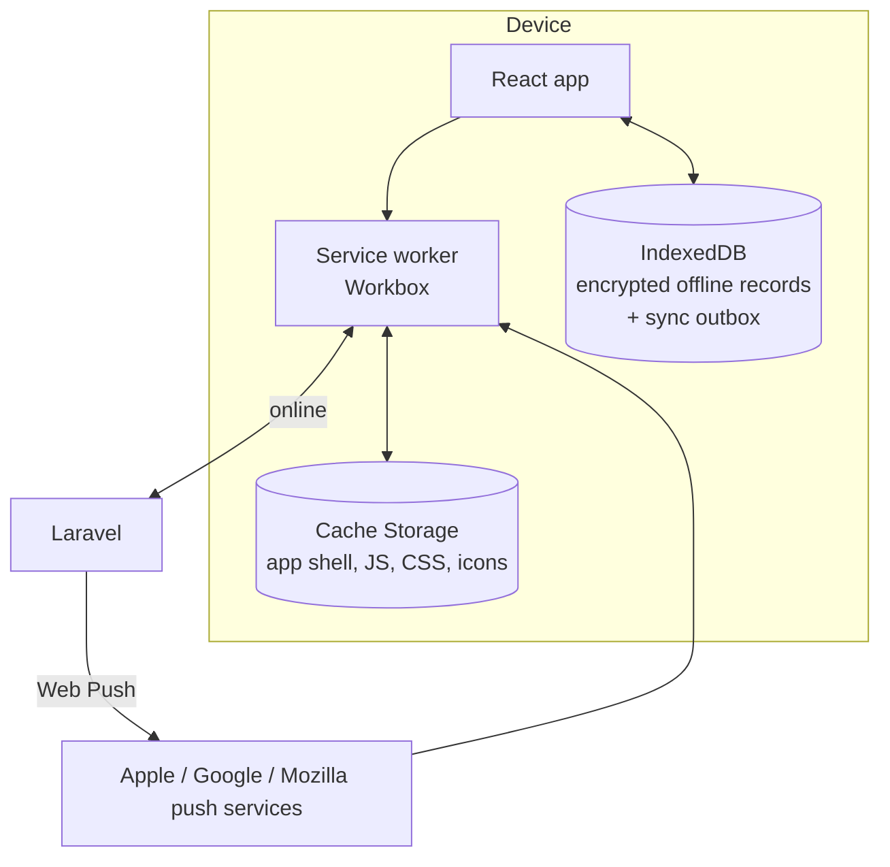

# I. PWA Architecture

## Components

| Piece                                                                       | What it does                                                                                                                                           |
| --------------------------------------------------------------------------- | ------------------------------------------------------------------------------------------------------------------------------------------------------ |
| **Web app manifest**                                                        | Name, icons (192/512 px + maskable + Apple touch icon), theme colour, `display: standalone`, start URL. Makes the app installable.                     |
| **Service worker** (built with `vite-plugin-pwa`, Workbox `injectManifest`) | Pre-caches the app shell and compiled assets; serves the offline page; receives push messages; manages updates ("A new version is available, reload"). |
| **IndexedDB**                                                               | Holds offline copies of _selected_ family data and a queue of offline edits.                                                                           |
| **Push**                                                                    | Web Push with VAPID keys via Laravel notifications.                                                                                                    |

## Caching rules (what is and isn't cached)

| Content                                | Strategy                                                                                         | Why                                                                                                             |
| -------------------------------------- | ------------------------------------------------------------------------------------------------ | --------------------------------------------------------------------------------------------------------------- |
| JS, CSS, fonts, icons                  | Pre-cache (versioned)                                                                            | Safe: contains no personal data.                                                                                |
| Inertia page responses (personal data) | **Network only. Never cached by the service worker.**                                            | Avoids silently storing every page someone views, including other people's private details, on a shared device. |
| Photo thumbnails                       | Cached only for families the user has made available offline, with a size cap (e.g. 200 MB, LRU) | Photos are personal data.                                                                                       |
| Offline family data                    | IndexedDB, **opt-in per family** ("Make this tree available offline")                            | The user decides what lives on the device.                                                                      |

### What "offline" includes

When a user makes a tree available offline, the app downloads a **privacy-filtered snapshot** (exactly what that user is allowed to see, nothing more): members, relationships, timeline and thumbnails. Restricted and private records are never included. The offline viewer can browse the tree, open profiles and search.

### Security of local data

- Snapshot data is encrypted in IndexedDB with an AES-GCM key generated by the Web Crypto API and stored as **non-extractable**.
- Honest limitation: this protects against someone copying the browser's files from disk. It does **not** protect against malware or a person using the unlocked phone itself, which is why offline is opt-in, filtered, and limited.
- **Logout wipes everything:** IndexedDB, cached thumbnails and the key. When an account is removed from a family, the next sync deletes that family's offline copy.
- Snapshots expire after 30 days without a successful sync.

## Offline editing and synchronisation

Inertia pages need the server, so offline mode uses a dedicated **Offline viewer** route whose shell is pre-cached and which reads from IndexedDB instead of Inertia props.

1. Offline edits (e.g. correcting a date, adding a note) go into an **outbox** in IndexedDB, each with the record's `version` at the time.
2. When the device is back online, the outbox is sent to a sync endpoint.
    - Triggered by the Background Sync API where supported (Chrome/Android), and by the `online` event plus app-focus as a fallback (**iOS has no Background Sync**).
3. The server applies each item through the **same Actions** as normal edits (same validation, permissions and audit). Contributors' offline edits become change requests.
4. If the record's `version` changed meanwhile, the item becomes a **conflict** the user resolves on screen (keep mine / keep theirs / merge). Nothing is overwritten silently.

v1 scope: offline **viewing** for everyone, offline **editing** of member fields and timeline entries. Adding relationships and uploading files require a connection (uploads can be queued from the camera roll, though).

## Camera and uploads

- `<input type="file" accept="image/*" capture="environment">` opens the camera on phones and works on iOS and Android without special permissions.
- Large uploads are resized on the device before upload (saves mobile data) and sent in chunks so a dropped connection can resume.
- HEIC photos from iPhones are accepted and converted to JPEG on the server.

## iOS Safari limitations and fallbacks

| Limitation                                                              | Fallback                                                                                                               |
| ----------------------------------------------------------------------- | ---------------------------------------------------------------------------------------------------------------------- |
| No install prompt (`beforeinstallprompt` is Chrome-only)                | A small in-app guide: "Tap Share → Add to Home Screen".                                                                |
| Web Push only for apps added to the Home Screen (iOS 16.4+)             | Email remains the primary channel; push is an extra. The settings page explains this on iOS.                           |
| No Background Sync                                                      | Sync on app open / focus / `online` event.                                                                             |
| Storage may be evicted after ~7 days of non-use for non-installed sites | Request persistent storage (`navigator.storage.persist()`); encourage installing; snapshot re-downloads automatically. |
| Storage quota smaller than on Android                                   | Thumbnail cache cap; the offline settings screen shows space used.                                                     |

## Path to native apps (Flutter / React Native)

No backend replacement is needed:

- `/api/v1` JSON endpoints (Sanctum tokens) call the same Actions and return the same Resources as the web app.
- The sync protocol (outbox + version check) is a documented API, usable by a native client too.
- UUID primary keys can be generated on the device.
- Native push (APNs/FCM) becomes an additional notification channel alongside Web Push.
