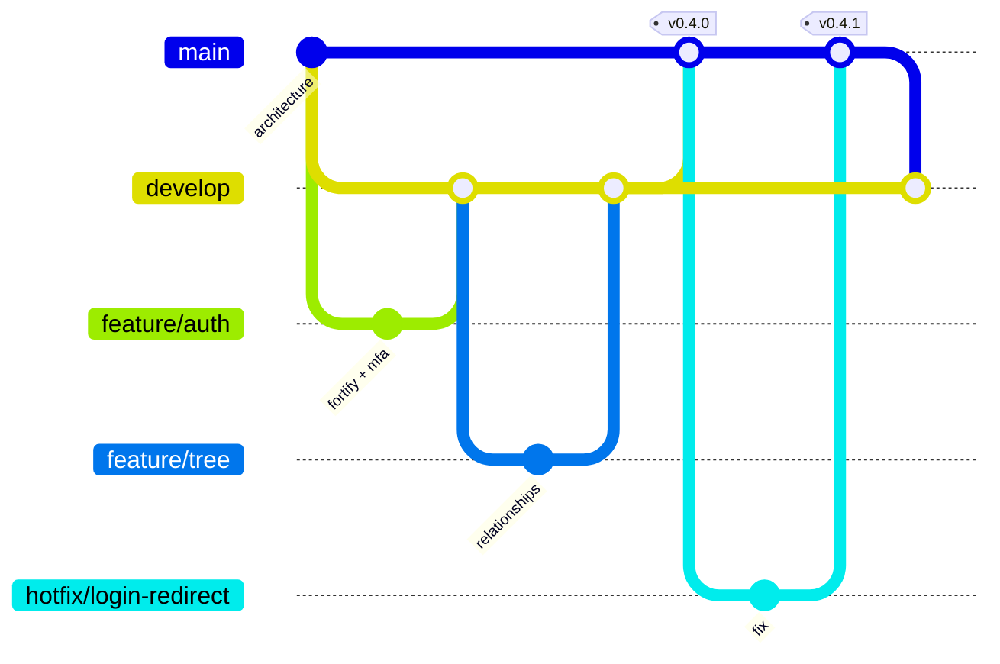

# J. GitHub Repository and Branching Strategy

Repository: `github.com/lorenzolowrince/MyFamilyTree` (should stay **private**).

## Branches

| Branch                          | Purpose                                                      | Deploys to                                                    | Protection                                    |
| ------------------------------- | ------------------------------------------------------------ | ------------------------------------------------------------- | --------------------------------------------- |
| `main`                          | Production-ready code. Every merge is a tagged release.      | **Production** (after manual approval in GitHub Environments) | PR only, CI green, 1 approval, no force-push. |
| `develop`                       | Integration of finished features.                            | **Staging** (automatically)                                   | PR only, CI green.                            |
| `feature/<module>-<short-name>` | One feature or fix, e.g. `feature/tree-d3-canvas`.           | Nothing (CI only)                                             | —                                             |
| `hotfix/<name>`                 | Urgent production fix from `main`, merged back to `develop`. | Production                                                    | Same as `main`.                               |

Commit style: **Conventional Commits** (`feat(tree): add hourglass view`, `fix(auth): ...`), which makes release notes automatic. Releases use semantic versioning tags (`v1.2.0`).

## Pull requests

- Template: what changed, why, screenshots for UI, migration notes, security considerations checklist.
- Small PRs (one feature slice), reviewed before merge.
- Migrations must be backwards-compatible with the currently deployed code (add column → deploy → backfill → remove old column later), so deployments never need downtime and rollbacks stay safe.

## CI (GitHub Actions), on every PR and push

| Job                         | Tools                                                                                                                                    |
| --------------------------- | ---------------------------------------------------------------------------------------------------------------------------------------- |
| PHP style + static analysis | Pint, Larastan (level 8), Rector (dry-run)                                                                                               |
| PHP tests                   | Pest against a real PostgreSQL 18 + Redis service container (no SQLite substitute: the triggers and constraints must be tested for real) |
| Frontend                    | ESLint, `tsc --noEmit`, Vitest, production build                                                                                         |
| Browser tests               | Critical journeys (register, MFA, add family, add relatives, approve change)                                                             |
| Security                    | `composer audit`, `npm audit --audit-level=high`, gitleaks secret scan, Dependabot                                                       |
| Coverage gate               | Genealogy services and Policies ≥ 90 %                                                                                                   |

## CD

| Trigger            | Action                                                                                                                 |
| ------------------ | ---------------------------------------------------------------------------------------------------------------------- |
| Merge to `develop` | Build → deploy to **staging** → run migrations → smoke test                                                            |
| Tag `v*` on `main` | Build → **wait for manual approval** → deploy to **production** → migrations → health check → auto-rollback on failure |

See [09-hosting-deployment.md](09-hosting-deployment.md) for how a deployment works.

## Environments

|         | Development                 | Staging                                                              | Production                                 |
| ------- | --------------------------- | -------------------------------------------------------------------- | ------------------------------------------ |
| Where   | Your PC (Docker/Sail)       | VPS (separate from prod; see K)                                      | VPS                                        |
| Data    | Seeded demo family          | Seeded demo family + anonymised samples. **Never real family data.** | Real                                       |
| Email   | Mailpit (captured locally)  | Mailpit/sandbox                                                      | Real provider                              |
| Storage | MinIO container             | Staging bucket                                                       | Production bucket                          |
| Secrets | `.env` (local, git-ignored) | GitHub Environment secrets → server `.env`                           | GitHub Environment secrets → server `.env` |
| Debug   | On                          | Off                                                                  | Off                                        |

## Secrets rules

- `.env`, keys, dumps and uploads are in `.gitignore` from the first commit; `.env.example` lists every variable with no real values.
- gitleaks runs in CI and as an optional pre-commit hook.
- If a secret is ever committed: rotate it immediately (rewriting git history is not enough; assume it is compromised).
