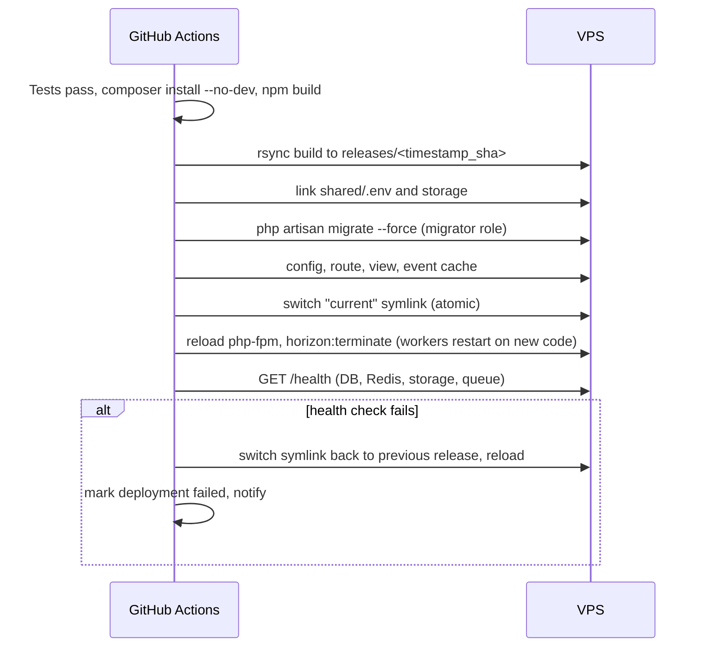

# K. Hosting and Deployment Architecture

## Recommended setup

|          | Production                                                 | Staging                                                 |
| -------- | ---------------------------------------------------------- | ------------------------------------------------------- |
| Server   | Hostinger VPS **KVM 2** (2 vCPU, 8 GB RAM, NVMe) or larger | Hostinger VPS **KVM 1** (1 vCPU, 4 GB RAM)              |
| OS       | Ubuntu LTS (minimal)                                       | Same                                                    |
| Domain   | `app.<your-domain>`                                        | `staging.<your-domain>` (password-protected, `noindex`) |
| Database | PostgreSQL 18 on the same VPS (localhost only)             | Same, separate server                                   |
| Storage  | Production bucket                                          | Separate staging bucket                                 |

**Why separate staging and production servers:** staging runs unreleased code. If a staging bug or misconfiguration exposes the server, production data must not be on it.
**Cheaper alternative (if budget requires):** staging on the production VPS under a separate Linux user, separate database and database user, separate Redis instance and separate bucket. Acceptable early on, but it shares the machine, so it should be split before real families are invited.

**When the database should move off the VPS:** when the server's CPU/RAM is regularly above ~60 %, or when you want managed high availability. Then move PostgreSQL to a managed service or a dedicated database VPS. The app only needs a config change.

## Server layout

```
/var/www/myfamilytree/
├── releases/
│   ├── 20261201120000_a1b2c3d/    # each deployment, kept: last 5
│   └── 20261205093000_e4f5a6b/
├── current -> releases/20261205093000_e4f5a6b   # symlink Nginx serves
└── shared/
    ├── .env                        # chmod 600, owner deploy
    └── storage/                    # logs, framework cache (media is in object storage)
```

Services (systemd): `nginx`, `php8.x-fpm` (dedicated pool, runs as user `myfamilytree`), `postgresql`, `redis-server`, `horizon` (supervised by systemd, restarts on failure), Laravel scheduler (systemd timer every minute), `clamav-daemon`.

## Server hardening

| Area                                | Configuration                                                                                                                                                                           |
| ----------------------------------- | --------------------------------------------------------------------------------------------------------------------------------------------------------------------------------------- |
| Firewall (UFW + Hostinger firewall) | Allow 22 (SSH, from your IP range if practical), 80, 443. Deny everything else. PostgreSQL 5432 and Redis 6379 are **never** exposed.                                                   |
| SSH                                 | Key-only (`PasswordAuthentication no`), no root login, non-default user, fail2ban.                                                                                                      |
| Updates                             | `unattended-upgrades` for security patches; monthly reviewed upgrades for PHP/PostgreSQL minor versions.                                                                                |
| PostgreSQL                          | Listens on localhost only. `scram-sha-256` auth. Separate roles: `app` (DML only, no DDL; INSERT/SELECT only on `audit_logs`), `migrator` (DDL, used only during deployment), `backup`. |
| Redis                               | Bound to localhost, `requirepass`, dangerous commands disabled (`FLUSHALL`, `CONFIG`).                                                                                                  |
| PHP                                 | `expose_php off`, `disable_functions` for shell execution functions not needed, OPcache with `validate_timestamps=0` (reset on deploy).                                                 |
| TLS                                 | Let's Encrypt via certbot, auto-renew, TLS 1.2+, OCSP stapling, A+ on SSL Labs.                                                                                                         |
| Users                               | A `deploy` user for GitHub Actions (can only write releases and reload PHP-FPM via a narrow `sudoers` rule).                                                                            |

## Deployment pipeline (zero downtime)



- **Assets are built in CI, not on the server.** Node is never installed in production (smaller attack surface).
- Tool: **Deployer** (PHP deployment tool, Laravel recipe), or an equivalent shell script. I'll propose the final choice in Phase 2.

### Database migrations

- Migrations run before the symlink switch and must be **backwards compatible** with the previous release (expand → migrate data → contract over two releases). So the old code keeps working if a rollback is needed.
- A backup checkpoint (`pgbackrest backup --type=incr`) is taken immediately before any release that contains migrations.

### Rollback

1. **Code:** `dep rollback` (or re-point the symlink to the previous release), which takes seconds.
2. **Database:** because migrations are backwards compatible, a code rollback normally needs no database rollback. If a migration damaged data, restore to the point in time just before the deployment (pgBackRest PITR) on a copy, verify, then switch.

### Health checks

`GET /health` (internal, token-protected) checks DB connectivity, pending migrations, Redis, queue backlog, storage write/read, disk space and the last successful backup time. Public `GET /up` (Laravel default) for the uptime monitor.

## Backups

| What                                       | How                                                                                                                                                                   | Retention                                               |
| ------------------------------------------ | --------------------------------------------------------------------------------------------------------------------------------------------------------------------- | ------------------------------------------------------- |
| PostgreSQL                                 | pgBackRest: continuous WAL archiving + nightly incremental, weekly full, **AES-256 encrypted**, to a backup bucket in a **different account/region** with object lock | 14 days point-in-time; daily 30 days; monthly 12 months |
| Media                                      | Bucket versioning + nightly replication to the backup bucket                                                                                                          | 30 days of versions                                     |
| Server config                              | Kept in the repo (`deploy/` folder: Nginx, PHP-FPM, systemd units), so a new server can be rebuilt from scratch                                                       | —                                                       |
| `.env` / `APP_KEY` / backup encryption key | Password manager + offline copy, held by the owner                                                                                                                    | —                                                       |

**Restore testing:** a monthly scheduled job restores the latest backup to a throwaway database, runs integrity checks (row counts, constraint validation, a sample relationship-finder query) and reports the result to the admin dashboard. A full server rebuild drill is done once before launch and then twice a year.

Targets: **RPO** (max data loss) ≈ 1 minute for the database, 24 h for media replicas. **RTO** (time to recover) ≤ 4 hours for a full server loss.

## Monitoring and logging

| What                                              | Tool                                                                                                    |
| ------------------------------------------------- | ------------------------------------------------------------------------------------------------------- |
| Uptime + TLS expiry                               | External uptime monitor (e.g. UptimeRobot or Better Stack) on `/up`                                     |
| App performance, slow queries, queues, exceptions | Laravel Pulse (self-hosted) + Horizon dashboard                                                         |
| Errors                                            | Laravel log + optional Sentry (only with personal data scrubbing; off by default for PDPA simplicity)   |
| Server                                            | Hostinger VPS metrics + `node_exporter`-style alerts on disk, CPU, RAM                                  |
| Logs                                              | Daily-rotated, 90 days on server; security logs shipped to the backup bucket                            |
| Alerts                                            | Email to Super Admins for downtime, failed backups, failed restore test, queue backlog, security events |

## Email

A transactional provider with good deliverability (e.g. Amazon SES in Singapore, Postmark or Brevo) with SPF, DKIM and DMARC records on the domain. The shared-hosting mailbox is not suitable for application mail.
