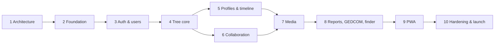

# L. Development Roadmap

Each phase ends with: working features on staging, automated tests, updated docs, a PR merged into `develop`, and your review before the next phase starts. Phases are ordered by dependency: each one only builds on finished ones.

| Phase | Scope | Done when |
|---|---|---|
| **1. Solution architecture** | These documents. | You approve them (with any changes). |
| **2. Project foundation** | Laravel + React starter kit (Inertia, TS, Tailwind, shadcn/ui); PostgreSQL + Redis + Mailpit + MinIO via Sail; CI pipeline (lint, types, tests, audits); base layout, navigation shell, light/dark theme; `develop` branch and branch protection; README. | `git clone` → one command → running app locally; CI green on a PR. |
| **3. Authentication & users** | Registration, email verification, login/logout, reset, Argon2id, MFA (TOTP + recovery codes), profile, sessions list/revoke, login history, deactivation, Google login; `families`, `family_user`, roles/permissions tables + seeders, Policies foundation; super-admin flag + admin shell. **Staging VPS provisioned at the end of this phase.** | All auth flows tested end-to-end; security review of auth passes; deployed to staging. |
| **4. Family tree core** | Create family, cover image (temporary local storage until Phase 7), `family_members`, `family_relationships` with constraints and trigger, fuzzy dates, places, Add parent/child/partner/sibling flows with duplicate check, placeholder parents, generations job, D3 tree (descendant, pedigree, hourglass; zoom, pan, expand/collapse, cards, preview, path highlight, list mode), member search (basic). | A 4-generation demo family with multiple marriages, adoption and half-siblings can be entered entirely through the UI and displayed correctly; invalid structures are rejected with clear messages. |
| **5. Profiles & history** | Full member profile page and editor, alternate names, living-person privacy and field masking, timeline (stored entries + derived births/deaths/marriages), family events (upcoming), dashboard widgets (members, generations, recent, upcoming birthdays/anniversaries, activity feed). | Profiles respect every privacy rule in the matrix (tests per role). |
| **6. Collaboration** | Invitations (email + secure link, expiry, revoke), role management, change requests with diff view and approve/reject, approval policy settings, optimistic locking conflicts, activity and audit logs, notifications (email) for invitations, pending approvals, new members. | A contributor's proposal flows through review to the live record with full audit trail. |
| **7. Media & documents** | S3 storage, upload pipeline (validation, quarantine, ClamAV, re-encode, EXIF strip, thumbnails, HEIC), albums, tagging people, timeline attachments, document preview/download permissions, storage quota and usage, photo notifications. | Malicious/invalid test files are rejected; GPS metadata is gone from served photos; quota enforced. |
| **8. Reports, GEDCOM & relationship finder** | Relationship finder with path visualisation; advanced search (surname, years, generation, location, branch); PDF reports (tree, ancestors, descendants, individual, directory, timeline); GEDCOM 7 export, import with validation, preview, duplicate detection and merge decisions. | Relationship calculator passes the full fixture suite; round-trip GEDCOM export → import produces the same tree. |
| **9. PWA** | Manifest, icons, service worker, install guidance (iOS), offline snapshot (opt-in, encrypted), offline viewer, outbox sync with conflicts, web push (birthdays, anniversaries, events, approvals), camera upload, mobile tree polish. | Installable on Android and iOS; works in airplane mode for an offline-enabled tree; push received on both. |
| **10. Hardening & launch** | Super-admin dashboard completion (stats, storage, security events, backups status), performance testing (10,000-member tree), OWASP ZAP + external pen test, accessibility audit (WCAG 2.2 AA), PDPA privacy notice (EN/BM), backup restore drill, production VPS provisioning and launch, UAT with your family. | Launch checklist signed off. |

## After launch (designed for, not built in v1)

Bahasa Malaysia translation (the i18n structure is built in from Phase 2, so this is translation work, not code changes) · AI suggestions (biography drafts, duplicate detection, relationship suggestions, document OCR), always via the `ai_suggestions` approval queue · migration maps (from `places` coordinates) · reunion management with RSVPs · passkeys · native apps on `/api/v1`.

## Risks to watch

| Risk | Mitigation |
|---|---|
| Relationship edge cases (cousin marriages, polygamy, adoption within the family) | Model supports them by design; fixture family covers them; calculator unit-tested before UI work. |
| D3 tree performance on phones with large trees | Focus-centred slices instead of whole-tree rendering; tested with 10,000 members in Phase 10. |
| GEDCOM files from other software are often non-standard | Tolerant parser with a warnings report and preview before anything is imported. |
| iOS PWA limits change between iOS versions | Email stays the primary channel; offline is an enhancement, not a requirement. |
| Scope size | Strict phase gates; each phase is usable on its own. |
